# Leon Leibmann

I'm a software engineer at Westbold, based in Portland, OR. I work on APIs, authentication, and developer tools.

I helped ship [Textverified’s MCP integration](https://www.textverified.com/ai-agents) and its OAuth authorization flow. Users can connect an AI assistant in the browser and choose what it can read or do without copying an API key.

## Selected work

- [EasyLabel](https://github.com/Pop101/EasyLabel): A terminal tool for labeling datasets. The layout was inspired by the color-coded buttons on a cash register.
- [GitHub Activity README](https://github.com/Pop101/github-full-activity-readme): A GitHub Action that keeps a README’s recent activity section up to date, including the one below.
- [Online community governance research](https://doi.org/10.1145/3757644): I worked with UW’s Behavioral Data Science Lab on how moderators see the rules and practices that govern their communities. Published at CSCW 2025.

I earned my B.S. in Computer Science at the University of Washington in 2025.

[Portfolio](https://leibmann.org) · [Résumé](https://github.com/Pop101/PortfolioSite/blob/main/Leon_Leibmann_Resume.pdf) · [Email](mailto:contact@leibmann.org)

## Recent activity

<!--START_SECTION:activity-->
1. 🎉 Created [Tasker-notification-forwarder](https://github.com/Pop101/tasker-notification-forwarder)
2. ⭐️ Starred [Awesome-copilot](https://github.com/github/awesome-copilot)
3. 🎉 Created [Chatterbox-mod](https://github.com/conversa-labs/chatterbox-mod)
4. ⭐️ Starred [Explainerdashboard](https://github.com/oegedijk/explainerdashboard)
5. 💪 Opened PR [#3](https://github.com/Westbold/PythonClient/pull/3) in [PythonClient](https://github.com/Westbold/PythonClient)
<!--END_SECTION:activity-->

Coding stats

